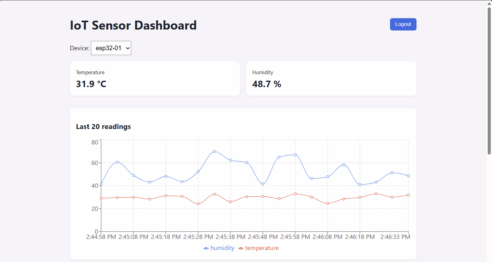
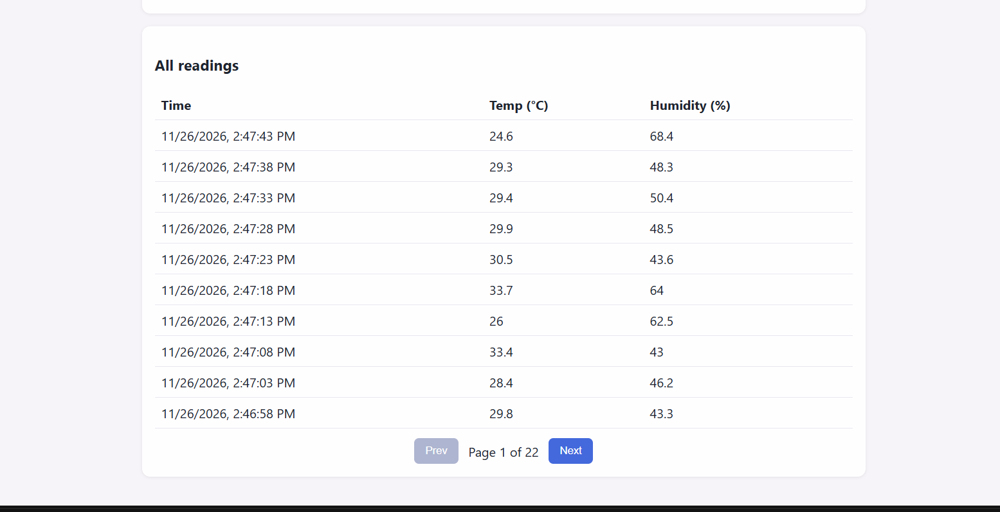
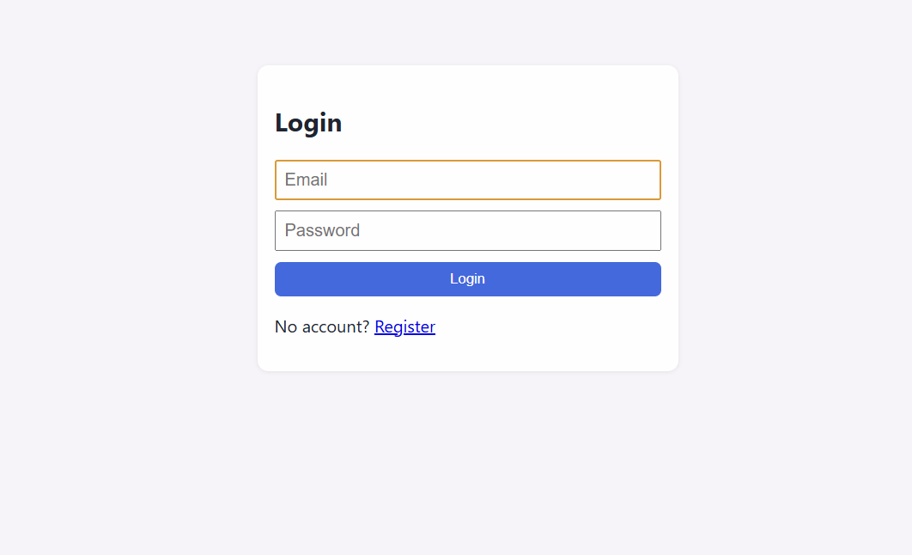

# IoT Sensor Dashboard (MERN)

A full-stack MERN application that collects temperature and humidity readings from sensors and shows them on a live dashboard. Devices post readings to a REST API using an API key. Users log in with JWT authentication to view the data in charts and tables.

> **Note:** Readings currently come from a simulator script (`backend/simulator.js`). The same endpoint accepts data from a real device such as an ESP32 with a DHT sensor.

## Screenshots

| Screenshot 1 | Screenshot 2 | Screenshot 3 |
|---|---|---|
|  |  |  |

## Tech Stack

- **MongoDB** (Atlas) with **Mongoose**
- **Express.js** and **Node.js**
- **React** (Vite), React Router, Axios, Recharts
- **Authentication:** JWT, bcrypt, API key for devices

## Features

- User registration and login with bcrypt password hashing and JWT
- Protected routes on both the API (`protect` middleware) and the frontend (`ProtectedRoute`)
- Device endpoint secured by an API key (`x-api-key` header)
- Readings API with filtering by device and date range, plus pagination
- Dashboard with the latest reading, a line chart of recent readings, a device selector, and a paginated table
- Auto-refresh every 5 seconds
- Centralized error-handling middleware

## How It Works

```
Device / simulator --(POST + x-api-key)--> Express API --> MongoDB Atlas
                                               ^
React dashboard --(GET + JWT Bearer token)-----+
```

## API Endpoints

| Method | Endpoint | Auth | Description |
|---|---|---|---|
| POST | `/api/auth/register` | None | Create a user |
| POST | `/api/auth/login` | None | Log in and receive a JWT |
| GET | `/api/me` | JWT | Current user |
| POST | `/api/readings` | API key | Device posts a reading |
| GET | `/api/readings` | JWT | List readings (`device`, `from`, `to`, `page`, `limit`) |
| GET | `/api/readings/latest` | JWT | Latest reading |
| GET | `/api/devices` | JWT | List of device names |

## Project Structure

```
iot-dashboard/
  backend/
    models/          # User and Reading schemas
    server.js        # Express app, routes, middleware
    simulator.js     # Fake sensor that posts readings
  frontend/
    src/
      pages/         # Login, Register, Dashboard
      api.js         # Axios instance with token interceptor
      ProtectedRoute.jsx
  screenshots/
```

## Getting Started

### Prerequisites
- Node.js 18 or newer
- A free MongoDB Atlas cluster

### 1. Backend
```bash
cd backend
npm install
```
Create `backend/.env` with these variables (use your own values):
```
JWT_SECRET=your_long_random_secret
MONGO_URI=your_mongodb_atlas_connection_string
DEVICE_API_KEY=your_device_key
```
Start the server:
```bash
npx nodemon server.js
```

### 2. Simulator (fake sensor)
In a second terminal:
```bash
cd backend
node simulator.js
```

### 3. Frontend
Create `frontend/.env`:
```
VITE_API_URL=http://localhost:5000/api
```
Then:
```bash
cd frontend
npm install
npm run dev
```
Open the address Vite prints (usually `http://localhost:5173`), register a user, log in, and the dashboard will show the simulated readings.

## What I Learned

- Building a REST API with Express middleware (logging, auth, error handling)
- Securing a user-facing API with JWT and a device-facing endpoint with an API key
- Modeling time-based data in MongoDB with an index on `device` and `timestamp`
- Connecting a React frontend to a protected API with an Axios interceptor

## Future Improvements

- Send data from a real ESP32 and DHT sensor
- Input validation with zod
- Rate limiting on login
- Threshold alerts
- Docker Compose setup and deployment with a live demo link
